---

## 🌟 About Me

- 🎓 Informatics Engineering student, Universitas Dian Nuswantoro (Semarang)
- 💻 **Bahasa**: Python, SQL, JavaScript
- 🌱 **Sedang belajar**: Deep Learning, MLOps, LLM / RAG
- 🎯 **Target**: AI Engineer
- 📊 **Fokus**: mengubah data mentah menjadi insight dan model ML yang siap dipakai

## 🛠️ Tech Stack

**Libraries:** `Pandas` · `NumPy` · `Scikit-learn` · `TensorFlow` · `PyTorch` · `Keras` · `XGBoost` · `HuggingFace` · `OpenCV` · `Matplotlib` · `Seaborn` · `Plotly`

**MLOps & Cloud:** `MLflow` · `DVC` · `FastAPI` · `Docker` · `Google Cloud` · `Streamlit`

## 🧠 What I Do
 
| | |
|---|---|
| 🤖 **AI / ML Engineering** | Membangun model ML dan sistem AI (RAG, chatbot, computer vision) |
| ⚙️ **Software Engineering** | Merancang aplikasi, REST API, dan database |
| 🌐 **Web Development** | Membuat website dan aplikasi web, frontend sampai backend |
| 🔍 **Data Analysis** | EDA, mencari pola dan insight dari dataset |
| 🧬 **Deep Learning** | CNN, RNN, Transformer untuk vision & NLP |
| 📦 **Deployment** | Model jadi REST API dengan FastAPI + Docker |
| 📈 **Visualisasi** | Dashboard dan cerita dari data |

## 📊 GitHub Stats
 

## 🌐 Connect

<picture>
  <source media="(prefers-color-scheme: dark)" srcset="https://raw.githubusercontent.com/AdnanAnwarR/AdnanAnwarR/output/pacman-contribution-graph-dark.svg">
  <source media="(prefers-color-scheme: light)" srcset="https://raw.githubusercontent.com/AdnanAnwarR/AdnanAnwarR/output/pacman-contribution-graph.svg">
  
</picture>

